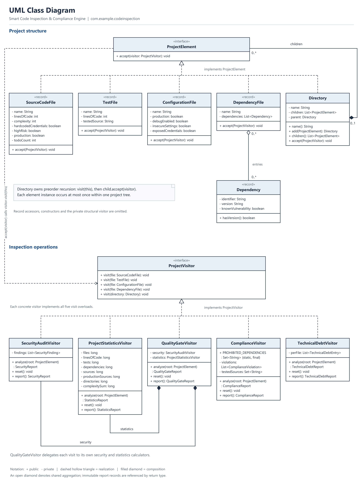
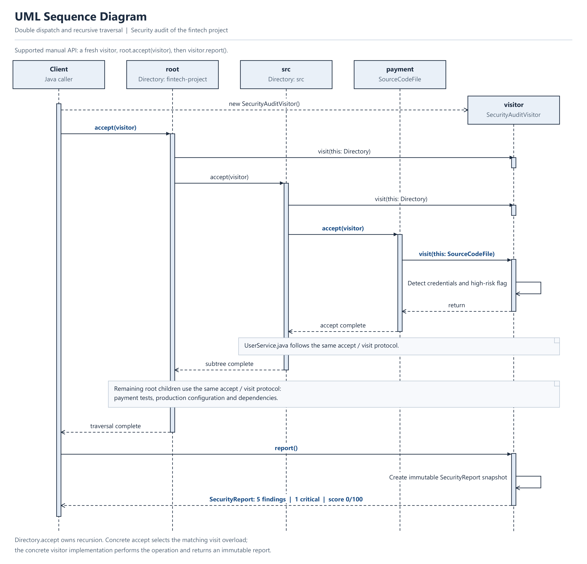

# Smart Code Inspection & Compliance Engine

Java 17 console application for Assignment 6. It applies the Visitor pattern to a
composite project tree, keeping inspection operations separate from project data.
The application analyzes supplied metadata; it does not parse Java files, measure
runtime test coverage, or query a vulnerability database.

## Build, test, and run

Requirements: JDK 17 or newer and Maven 3.8 or newer. Set `JAVA_HOME` to the JDK
and put Maven's `bin` directory on `PATH`. No application dependencies are required;
JUnit 5.10.2 is used only for tests. Maven downloads build plugins and test dependencies
on the first build.

From the directory containing `pom.xml`:

```sh
mvn compile
mvn clean test
mvn exec:java
```

`exec:java` runs the compiled classes, so compile or run the tests first. To package
and verify the project, use `mvn clean verify`. The main class is
`com.example.codeinspection.demo.Main`; an IDE can run it directly.

The suite has **37 JUnit 5 tests** across seven test classes. It covers dispatch,
recursive traversal, cycle prevention, constructor validation, immutable snapshots,
security rules, fractional statistics, exact and near-threshold boundaries, missing
production data, deferred compliance, visitor reuse, debt arithmetic, and console integration.
Surefire writes the actual results to `target/surefire-reports/`.

## Model and traversal

All types are in `com.example.codeinspection`, organized into `model`, `visitor`,
`report`, and `demo` packages.

| Element | Data |
| --- | --- |
| `SourceCodeFile` | Name, LOC, complexity, credentials flag, risk flag, production flag, TODO/FIXME count |
| `TestFile` | Name, LOC, exact name of its tested source |
| `ConfigurationFile` | Name, production/debug/insecure-settings/exposed-credentials flags |
| `DependencyFile` | Name and an immutable list of `Dependency` entries (identifier, optional version, vulnerability flag) |
| `Directory` | Name and ordered children, including nested or empty directories |

File models are immutable Java records with validated constructors and record
accessors such as `name()`. Numeric metadata must be nonnegative; names must be
nonblank. Names and dependency versions are stripped of surrounding whitespace.
Dependency versions may be null or blank so inspections can report invalid manifests.

`Directory.accept(visitor)` visits the directory first, then calls `accept` on
each child. Visitors never recurse over children. Directories reject self-cycles,
ancestor cycles, duplicate children, null children, and directories already attached
to another parent. Within one project tree, each element instance may occur only once;
this is checked when adding files to nested directories and when attaching prebuilt
subtrees. Distinct immutable records with equal metadata can represent separate files
in different directories. Child access returns an immutable snapshot. All five visitors
are tested together with 500 nested directories and an empty sibling directory.

Each visitor has `analyze(root)`, `reset()`, and `report()`. `analyze` resets state,
traverses once, and returns an immutable report snapshot. For manual traversal,
use a fresh visitor (or call `reset()`), then `root.accept(visitor)` and `report()`.
Calling `report()` repeatedly does not accumulate findings or finalize the visitor.
Visitor instances and mutable directories are intended for single-threaded use.

## Analysis rules

| Visitor | Operation |
| --- | --- |
| `SecurityAuditVisitor` | Finds credentials, vulnerable dependency metadata, insecure settings, production debug mode, and high-risk source files |
| `ProjectStatisticsVisitor` | Counts files, source/test LOC, test files, dependency entries, source complexity, and test/source ratio |
| `QualityGateVisitor` | Delegates each visit to its own security and statistics visitors and evaluates release thresholds |
| `ComplianceVisitor` | Checks credentials, explicit versions, production test relationships, and prohibited dependencies |
| `TechnicalDebtVisitor` | Estimates source remediation effort from TODO/FIXME counts, excess complexity, and risk |

**Security:** source/configuration credentials are CRITICAL; vulnerable dependencies,
high-risk sources, and production debug mode are HIGH; other insecure settings are
MEDIUM. LOW is available in the severity model. Only **CRITICAL** findings block the
security gate; HIGH findings remain visible but do not count as critical.
The informational score is `max(0, 100 - 40*C - 20*H - 10*M - 5*L)`, where each
letter is the corresponding finding count. Scores stay within 0–100; no findings
means score 100 and zero critical issues. Multiple problems in one file produce
separate findings. Dependency vulnerabilities are caller-supplied metadata, not a
claim about a real package or a live vulnerability scan.

**Statistics:** total files excludes directories. LOC sums source and test LOC only.
Dependencies counts entries across all manifests, including repeated declarations.
Average complexity is the arithmetic mean across **all** source files. Test/source
ratio is test file count divided by **all** source file count, using floating-point
division. Both averages/ratios are zero when there are no sources. Counters and sums
use `long` to avoid integer overflow when aggregating large metadata values.

**Quality gate:** security passes with zero critical findings; complexity passes at
average complexity ≤ 10; tests pass at ratio ≥ 0.40 **and at least one production
source**. All three must pass for final PASS; otherwise the result is FAILED.
Empty, test-only, and nonproduction-only projects therefore cannot appear ready
for release. The ratio is an aggregate proxy, not execution coverage or proof that
every production module has tests; compliance checks individual relationships.
The quality report displays metric values without rounding to two decimal places,
so values just outside a threshold remain visibly different from the boundary.

**Compliance:** null, empty, and whitespace-only dependency versions fail. Other
version strings are accepted as explicit versions; version syntax and inherited
Maven dependency management are outside this metadata model. Prohibited identifiers
are the exact, case-sensitive set `org.example:unsafe-crypto` and
`org.example:unlicensed-sdk`; other identifiers are permitted.

After collection, every production source must match a test whose `testedSource()`
equals the source's `name()` exactly and case-sensitively. Use unique project-relative
names for same-named files in different modules. Duplicate source identifiers are
ambiguous and cannot satisfy this rule. Test/source directory order does not affect
matching. Nonproduction sources do not require tests. Empty projects are COMPLIANT
(no policy violations), but fail the quality gate's production-source requirement.
Compliance checks exactly the four stated policies; security findings such as debug
mode remain in the security report.

**Technical debt:** estimated minutes per source file are
`30 * todoCount + 60 * max(0, complexity - 10) + (highRisk ? 120 : 0)`.
The project total sums file estimates. Every source has an itemized entry; only
positive estimates count as findings. These are deterministic demonstration effort
estimates, not measured engineering time. Other element types add no debt.

## Fintech demonstration

`FintechProject.create()` constructs this exact in-memory hierarchy. Physical files
are not needed or read by the demo:

```text
fintech-project/
├── src/
│   ├── PaymentService.java
│   └── UserService.java
├── tests/
│   └── PaymentServiceTest.java
├── config/
│   └── application.properties
└── pom.xml
```

PaymentService has LOC 180, complexity 12, three TODOs, and synthetic credentials/risk
flags. UserService has LOC 120, complexity 6, one TODO, and no security flags. Both
are production sources. The payment test contributes LOC 90. The production config
has debug mode and insecure settings enabled. The manifest declares three fictional
dependencies: a safe payment SDK at 2.4.0, legacy JSON at 1.0.0 with a vulnerability
flag, and prohibited unsafe crypto with a blank version. No actual secret is stored.
All five visitors analyze the same object tree.

| Expected result | Value |
| --- | --- |
| Files / directories | 5 / 4 (including root) |
| Source files / test files | 2 / 1 |
| LOC | 180 + 120 + 90 = 390 |
| Dependency entries | 3 |
| Average complexity | (12 + 6) / 2 = 9.00 |
| Test/source ratio | 1 / 2 = 0.50 |
| Security findings | 5: 1 CRITICAL, 3 HIGH, 1 MEDIUM |
| Security score | max(0, 100 − 40 − 60 − 10) = 0 |
| Quality gate | Security FAIL; complexity PASS; tests PASS; final FAILED |
| Compliance | 4 violations; NON-COMPLIANT |
| Technical debt | Payment 330 + User 30 = 360 minutes; 2 affected files |

The four compliance violations are PaymentService credentials, unsafe-crypto's
missing version, unsafe-crypto's prohibited identifier, and UserService's missing
test. These results are independently asserted in the test suite.

## UML

The class diagram shows the five element types, five analysis visitors, directory
composition, and quality gate delegation. The sequence diagram shows the supported
manual traversal API, recursive processing, double dispatch, and report creation.
Both diagrams are high-resolution PNG images; open an image to inspect its full size.





## Required Visitor questions

### 1. What problem does Visitor solve in this project?

It separates project structure from inspection operations. Security, statistics,
quality, compliance, and debt can evolve independently of the five element classes.
A new inspection implements the visitor interface without modifying those elements.

### 2. Where are Element and Visitor?

`model.ProjectElement` is the element interface. Its concrete elements are
`SourceCodeFile`, `TestFile`, `ConfigurationFile`, `DependencyFile`, and `Directory`.
`visitor.ProjectVisitor` defines five overloaded visits. Its five analysis
implementations are `SecurityAuditVisitor`, `ProjectStatisticsVisitor`,
`QualityGateVisitor`, `ComplianceVisitor`, and `TechnicalDebtVisitor`.
Directory also uses a private structural visitor to validate candidate subtrees.

### 3. What is double dispatch?

First, `element.accept(visitor)` dynamically selects the concrete element's method.
Inside that method, the concrete type of `this` selects the matching overload;
dynamic dispatch then selects the visitor implementation. For example, the actual
`SourceCodeFile.accept` implementation is:

```java
public void accept(ProjectVisitor visitor) {
    Objects.requireNonNull(visitor, "visitor").visit(this);
}
```

Here `this` is statically `SourceCodeFile`, so a `SecurityAuditVisitor` receives
`visit(SourceCodeFile)`, even when callers hold the file as a `ProjectElement`.
No conditional element type checks or reflective dispatch are needed.

### 4. Why not put all operations directly inside element classes?

Files and directories should represent data and structure. Embedding each analysis
there mixes responsibilities and forces edits to every element for each operation.
Visitors keep related inspection logic together and make it independently testable.

### 5. Is it easier to add a new Visitor or a new Element? Why?

A new visitor is easier when the element hierarchy is stable: implement the five
existing overloads and leave all elements unchanged. The TechnicalDebtVisitor commit
demonstrates this. A new element requires a new interface overload and corresponding
methods in every visitor, as well as the element itself.

### 6. When would Visitor be a bad choice?

When element types change frequently, updating every visitor becomes costly. A
small, stable set of operations on a rapidly growing hierarchy may fit polymorphic
element methods better. Visitor also requires elements to expose the metadata that
operations need.

### 7. How is Visitor different from Strategy?

Visitor adds operations over a heterogeneous element structure using double
dispatch. Strategy encapsulates interchangeable algorithms behind a common
behavioral interface for a context to select. Strategy does not inherently define
one overload for each element type or traverse an element hierarchy.

### 8. Which SOLID principles can you identify?

- **Single Responsibility:** model records hold data, visitors collect analysis,
  report records derive results and format them, and Main coordinates the demo.
- **Open/Closed:** new operations such as technical debt extend the existing
  visitor contract without editing concrete elements. This benefit applies to
  operations; adding element types still requires changes.
- **Dependency Inversion:** elements accept the `ProjectVisitor` abstraction and
  traversal stores the `ProjectElement` abstraction. They do not depend on any
  specific analysis visitor. QualityGateVisitor intentionally composes the concrete
  security/statistics calculators to keep those rules consistent.

### Limitation challenge: adding DatabaseMigrationFile

1. Create `DatabaseMigrationFile implements ProjectElement`.
2. Implement its `accept(ProjectVisitor visitor)` with `visitor.visit(this)`.
3. Add `visit(DatabaseMigrationFile file)` to `ProjectVisitor`.
4. Implement that overload in every existing concrete visitor, including Directory's
   private structural visitor and the test recording visitor.
5. Update relevant demo construction, tests, and UML diagrams.

The existing five elements need no change. The visitor interface and implementations
do change: Visitor makes new operations convenient at the cost of expanding the
element hierarchy. DatabaseMigrationFile is a conceptual example, not a sixth
implemented element.
