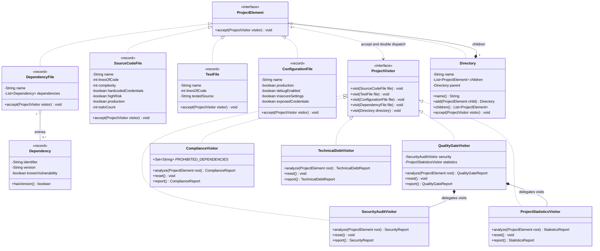
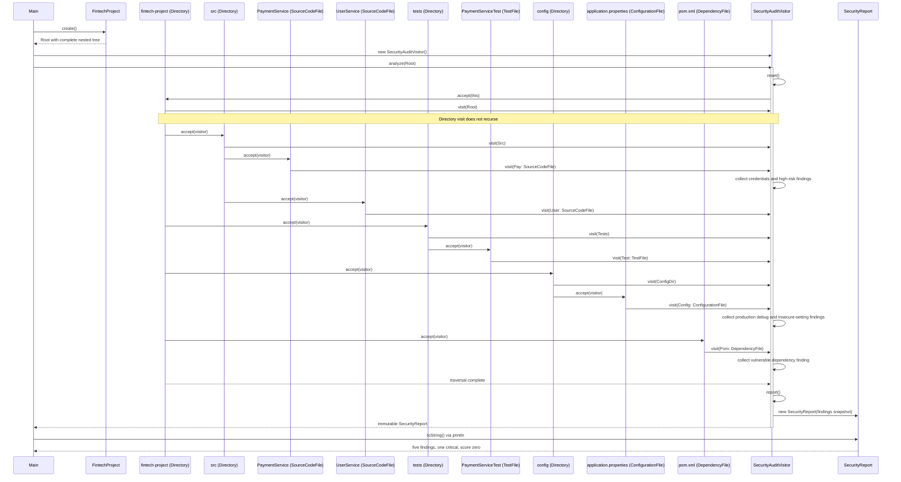

# UML diagrams

These diagrams show the implemented production structure. File elements are Java
records; Directory is a mutable composite. Each analysis visitor implements all five
overloads declared by ProjectVisitor. Only the core domain and inspection classes
are shown; immutable result records and Directory's private validation visitor are
omitted for readability.

## Class diagram

## Sequence diagram

The security traversal below uses the actual nested fintech fixture. Directory owns
traversal; `visit(Directory)` never traverses its children. Other analyses follow
the same dispatch protocol on the same tree. Compliance defers its cross-file test
matching until `report()` after collection.

