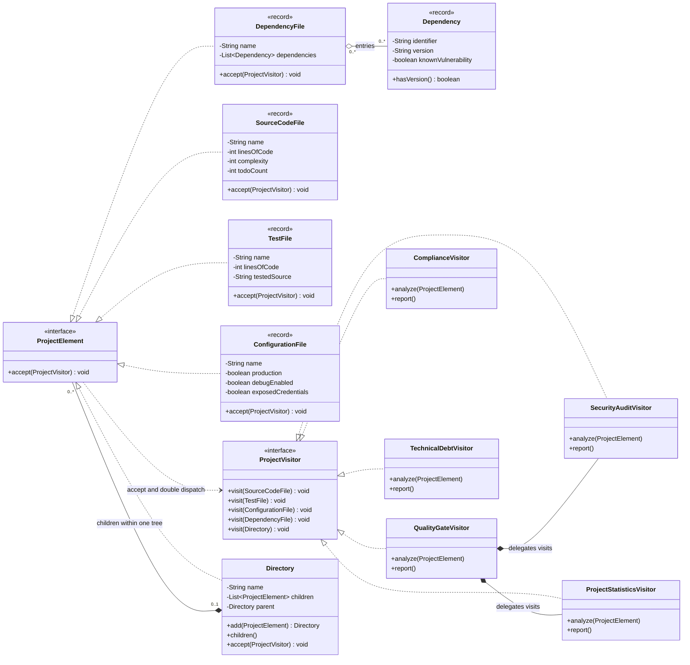
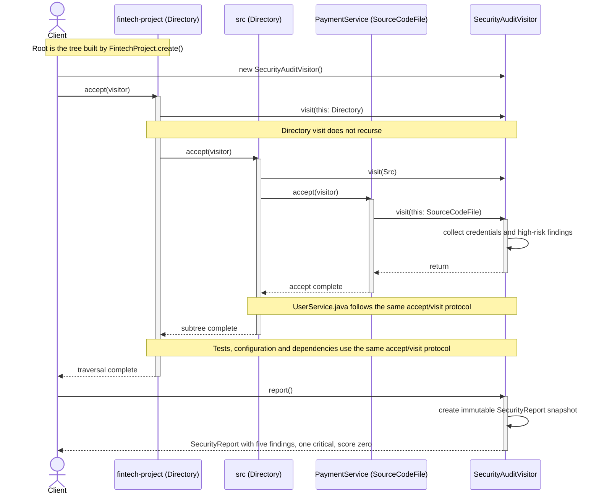

# UML diagram source

The submission images are `uml-class-diagram.png` and `uml-sequence-diagram.png`,
embedded directly in README. The Mermaid definitions below retain editable views
of the same implementation. File elements are Java
records; Directory is a mutable composite. Each analysis visitor implements all five
overloads declared by ProjectVisitor. Key properties and methods are shown; immutable
result records and Directory's private validation visitor are omitted for readability.
Every analysis visitor also exposes the `reset()` lifecycle method described in README.

## Class diagram

## Sequence diagram

The security traversal below uses the supported manual API on the fintech fixture.
The client creates a fresh visitor, invokes `root.accept(visitor)`, and requests
`report()` after traversal. Subsequent children are summarized to keep the diagram readable. Directory
owns traversal; `visit(Directory)` never traverses its children. Other analyses follow
the same dispatch protocol on the same tree. Compliance defers its cross-file test
matching until `report()` after collection. Root elements have no parent; each element
instance occurs at most once within a project tree.

